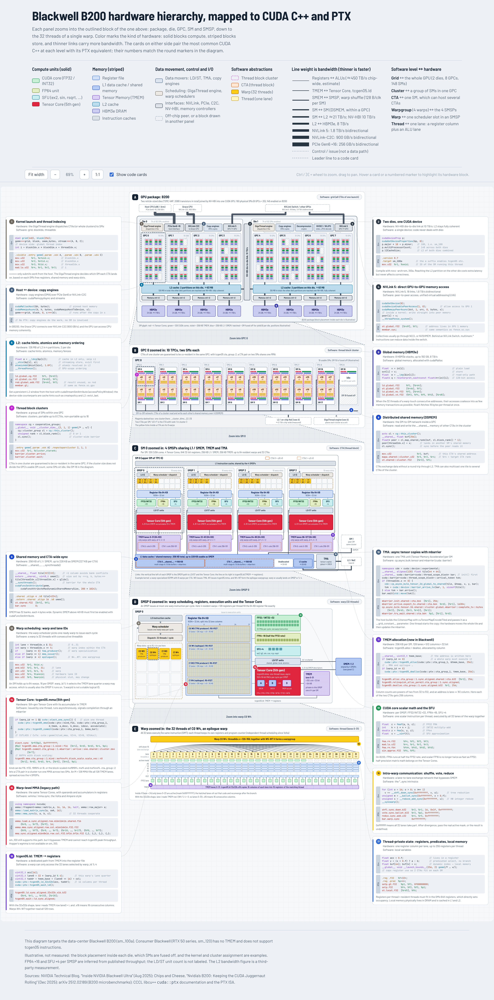

nowadays ai is the only best teacher, professor, text books, tech documents, playgrounds, ...

u do not copy this repo; instead, you ask ur AI to DIY ur own

## examples

### [NVIDIA Blackwell (B200): hardware hierarchy × CUDA / PTX](ai-all/infra/architecture/nvidia-blackwell/)

**What you can ask AI to teach:**

> I need you to build a topology visualization of the Blackwell GPU architecture hierarchy. First, a set of blocks that fully shows the GPU's hardware structure (just the topology diagram is enough), with different structures in different colors, and then the communication between them (different speeds as different line thicknesses: the faster, the thinner). Then, around the topology diagram, I want you to annotate the most important CUDA programming code (PTX and the equivalent CUDA C++). The diagram must show every level of partitioning within a single GPU: from multiple CTAs / shared memory, to warps (warps in yellow), to the threads inside a warp. Compute units and memory units must be explicitly distinguished, and Tensor Cores in particular must be drawn out explicitly. Draw me a first version, in HTML.

**What AI gets you:**

